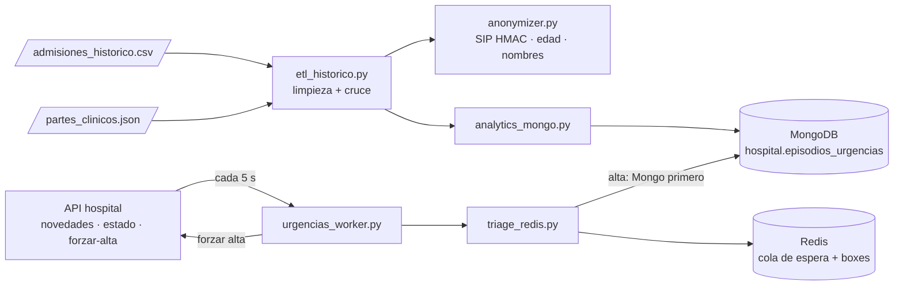

# EmergencyTracker

Herramienta para la gestión del servicio de **Urgencias hospitalarias**: limpia y cruza el histórico de admisiones con los partes clínicos, gestiona en tiempo real la **cola de triaje (Manchester)** y la **asignación de pacientes a boxes** con Redis, carga los episodios en **MongoDB** para su análisis y **anonimiza** los datos de los pacientes. Incluye una **rotación automática de boxes por estancia máxima** pensada para la demo.

---

## Índice

1. [Descripción general](#descripción-general)
2. [Arquitectura](#arquitectura)
3. [Tecnologías](#tecnologías)
4. [Estructura del proyecto](#estructura-del-proyecto)
5. [Datos de entrada](#datos-de-entrada)
6. [Módulos](#módulos)
7. [Instalación y puesta en marcha](#instalación-y-puesta-en-marcha)
8. [Rotación de boxes para la demo](#rotación-de-boxes-para-la-demo)
9. [Comprobar que funciona](#comprobar-que-funciona)
10. [Gestión de errores](#gestión-de-errores)
11. [Equipo](#equipo)
12. [Criterios de finalización](#criterios-de-finalización)
13. [Planificación (Trello)](#planificación-trello)
14. [Cronología del desarrollo](#cronología-del-desarrollo)
15. [Estado actual y trabajo pendiente](#estado-actual-y-trabajo-pendiente)

---

## Descripción general

El proyecto cubre cuatro necesidades de un servicio de Urgencias:

| Bloque | Qué hace | Módulo |
|---|---|---|
| **ETL del histórico** | Lee `admisiones_historico.csv` y `partes_clinicos.json`, limpia errores, normaliza formatos y cruza ambos ficheros por `id_episodio`. | `src/etl_historico.py` |
| **Triaje y boxes en tiempo real** | Consulta cada 5 s la API del hospital, mete los nuevos ingresos en una cola ordenada por prioridad (algoritmo *Earliest Deadline First*), asigna pacientes a los 5 boxes y libera los boxes con las altas. | `src/urgencias_worker.py`, `src/triage_redis.py` |
| **Analítica** | Carga los episodios en MongoDB y calcula la estancia media por patología y el destino al alta por grupo de edad. | `src/analytics_mongo.py` |
| **Anonimización** | Seudonimiza el SIP con HMAC‑SHA256, agrupa la edad en décadas y elimina los nombres. | `src/anonymizer.py` |

Además, para la demo existe una **rotación automática**: si un paciente supera `MAX_STAY_MIN` minutos en un box, el worker fuerza su alta en el simulador para que el box se libere y entre el siguiente paciente de la cola.

---

## Arquitectura



Flujo de `main.py`:

1. Ejecuta el ETL completo (lectura → limpieza → cruce).
2. Anonimiza el DataFrame resultante del ETL.
3. Conecta con Redis (`REDIS_HOST:REDIS_PORT`, por defecto `localhost:6379`).
4. Crea el índice único de MongoDB con `mongo.init_index()`.
5. Inicializa los boxes si no existen.
6. Arranca el worker de urgencias:
   - con `RESET_REDIS=1`, vacía la cola y los boxes antes de empezar;
   - con `RESET_REDIS=0`, sincroniza con el censo del simulador;
   - después entra en el bucle continuo de 5 segundos.

---

## Tecnologías

- **Python 3.11**
- **pandas / numpy**: ETL y limpieza de datos
- **Redis** (`redis-py`): cola de triaje y estado de los boxes en tiempo real
- **MongoDB** (`pymongo`): almacenamiento y consultas de agregación
- **requests**: consumo de la API del hospital
- **python-dotenv**: carga de la clave secreta y variables de la demo desde `.env`
- **hmac / hashlib** (librería estándar): anonimización
- **Docker Compose**: contenedores de la app, MongoDB y Redis
- **Git + GitHub** para el código y **Trello** para la organización de tareas

---

## Estructura del proyecto

```
EmergencyTracker/
├── data/
│   ├── admisiones_historico.csv   # Histórico de admisiones (3.605 filas)
│   └── partes_clinicos.json       # Partes clínicos de triaje (3.418 registros)
├── src/
│   ├── config.py                  # Rutas, API, conexión Mongo, HMAC y demo
│   ├── etl_historico.py           # Lectura, limpieza y cruce de datos
│   ├── triage_redis.py            # Boxes y cola de espera en Redis
│   ├── urgencias_worker.py        # Worker que consulta la API del hospital
│   ├── anonymizer.py              # Anonimización de los datos
│   └── analytics_mongo.py         # Carga en MongoDB y consultas analíticas
├── main.py                        # Punto de entrada
├── docker-compose.yml             # Servicios: app, mongodb, redis
├── requirements.txt               # Dependencias de Python
├── .env                           # HMAC_SECRET y variables de la demo (no se sube a Git)
└── .gitignore
```

---

## Datos de entrada

Los ficheros históricos se obtienen del servidor remoto del proyecto (`10.201.59.248:8088`); el código trabaja con la copia local de la carpeta `data/`.

### `data/admisiones_historico.csv`

3.605 filas con las columnas:

| Columna | Descripción |
|---|---|
| `id_episodio` | Identificador del episodio (`EP-2026-XXXXX`) |
| `sip_paciente` | Identificador sanitario del paciente (`SIP-XXXXXX`) |
| `timestamp_llegada` / `timestamp_alta` | Fecha y hora de llegada y de alta |
| `motivo_consulta` | `Urgencia por <especialidad>` (9 especialidades) |
| `frecuencia_cardiaca` | Frecuencia cardíaca en admisión |
| `tension_arterial` | Tensión arterial `sistólica/diastólica` |
| `destino_alta` | Domicilio, ingreso en planta, ingreso en pediatría, observación, traslado a UCI, fallecimiento… |

### `data/partes_clinicos.json`

3.418 partes clínicos. Cada uno contiene:

- `_id_parte`, `id_episodio`, `sip_paciente`, `edad`
- `triaje_manchester`: `nivel`, `color`, `categoria_patologia`, `tiempo_max_espera_min`
- `constantes`: `temperatura_c`, `frecuencia_cardiaca_triaje`, `saturacion_o2`, `glucemia_mg_dl`
- `antecedentes` y `alergias` (listas), `notas_triaje` (texto libre)
- Un **módulo de especialidad** según la patología: `modulo_cardiologia`, `modulo_digestivo`, `modulo_neurologia`, `modulo_traumatologia`, `modulo_urologia`, `modulo_pediatria`, `modulo_infeccioso`, `modulo_respiratorio` o `modulo_psiquiatria`, cada uno con sus campos propios (p. ej. Glasgow y NIHSS en neurología, Killip y troponinas en cardiología, qSOFA en infeccioso).

Categorías patológicas: Cardiovascular, Digestivo, Neurología, Traumatología, Nefrourología, Pediatría, Infeccioso, Respiratorio y Psiquiatría.

---

## Módulos

### `src/config.py`

Centraliza la configuración:

- `RUTA_CSV` y `RUTA_JSON`: rutas relativas a la carpeta `data/`.
- `RUTA_API`: `http://10.201.59.248:28000/api/v1/urgencias/novedades`.
- `RUTA_API_ESTADO`: `http://10.201.59.248:28000/api/v1/simulador/estado`.
- `RUTA_API_FORZAR_ALTA`: `http://10.201.59.248:28000/api/v1/profesor/forzar-alta`.
- `REDIS_HOST`, `REDIS_PORT`, `MONGO_HOST` y `MONGO_PORT`: se leen de variables de entorno. Si no existen se usa `localhost` con los puertos 6379 y 27017, que es lo que hace falta al ejecutar en local. Dentro de Docker, el `docker-compose.yml` los define con el nombre de cada servicio (`redis` y `mongodb`).
- `MONGO_URI` (se construye como `mongodb://MONGO_HOST:MONGO_PORT`), `MONGO_DB` (`hospital`) y `MONGO_COLLECTION` (`episodios_urgencias`).
- `HMAC_SECRET`: se lee del fichero `.env`. **Si no existe, el programa se detiene** con un `ValueError`.

Variables de la demo:

| Variable | Por defecto | Descripción |
|---|---|---|
| `MAX_STAY_MIN` | `3` | Minutos máximos que un paciente puede ocupar un box antes de forzar su alta. `0` desactiva la rotación automática. |
| `RESET_REDIS` | `0` | `1` vacía la cola y libera los 5 boxes al arrancar. `0` conserva el estado y lo sincroniza con el censo. |

### `src/etl_historico.py` — Extracción, limpieza y cruce

Función principal: `etl_historico(ruta_csv, ruta_json)` → devuelve un DataFrame con un episodio por fila.

**1. Extracción** (`funcion_lectura`): carga el CSV con `pandas.read_csv` y el JSON con `pandas.read_json`.

**2. Limpieza del CSV** (`limpieza_csv`):

| Paso | Detalle |
|---|---|
| Nulos y duplicados | Elimina filas sin `id_episodio` y duplicados por episodio (se queda con el primero): 3.605 → 3.453 filas. |
| Fechas | Convierte `timestamp_llegada` y `timestamp_alta` a `datetime` en UTC aceptando formatos mezclados (`format='mixed'`, `dayfirst=True`). Lo que no se puede interpretar queda como `NaT`. |
| Textos | `strip()` + minúsculas en todas las columnas de texto. |
| Frecuencia cardíaca | Pasa a numérico; valores ≤ 0 o > 250 → nulo; detecta atípicos con el **rango intercuartílico (IQR, 1,5×)** y los pasa a nulo; imputa los nulos con la **mediana**. |
| Tensión arterial | Sustituye `_` por `/`; `nan` y `pendiente` → `desconocido`. |
| Destino al alta | Nulos y `pendiente` → `desconocido`. |

**3. Limpieza del JSON** (`limpieza_json`):

- Elimina registros sin `id_episodio` y duplicados.
- Normaliza **recursivamente** todos los textos, también dentro de listas y diccionarios anidados (`normalizar_valores_json`).
- Valida las constantes vitales; los valores fuera de rango pasan a `None`:
  - Temperatura: 30–45 °C
  - Frecuencia cardíaca de triaje: 30–250 lpm
  - Saturación de O₂: 0–100 %

**4. Cruce** (`cruzar_datos`): normaliza `id_episodio` en ambos lados y hace un *inner join*. Con los datos actuales se obtienen **3.374 episodios cruzados, sin duplicados**, con 25 columnas.

### `src/triage_redis.py` — Cola de triaje y boxes

Modelo de datos en Redis:

| Clave | Tipo | Contenido |
|---|---|---|
| `box:1` … `box:5` | Hash | `box_id`, `estado` (`LIBRE` / `OCUPADO`), `id_episodio`, `hora_entrada`, `hora_entrada_ts` |
| `urgencias:cola_espera` | Sorted set | Miembro: `id_episodio` · Puntuación: **deadline** del paciente |

`hora_entrada_ts` guarda el instante de entrada como *epoch* (segundos). Es el dato que usa el worker para calcular cuánto lleva el paciente en el box. Si un box antiguo no tiene ese campo, `obtener_boxes` lo reconstruye a partir de `hora_entrada`.

**Priorización — Earliest Deadline First (EDF)**: la puntuación de cada paciente es su hora límite de atención:

```
deadline = timestamp_llegada + tiempo_max_espera_min × 60
```

El siguiente paciente en entrar a box es siempre el de **deadline más cercano** (`ZRANGE … 0 0`). Así, un paciente rojo (0 min) que acaba de llegar pasa por delante de un verde que lleva un rato esperando, pero un verde cuyo plazo está a punto de vencer también acaba teniendo prioridad.

Funciones principales:

| Función | Qué hace |
|---|---|
| `inicializar_redis` / `inicializar_boxes` | Crea los 5 boxes en estado `LIBRE` si no existen (no pisa el estado previo). |
| `obtener_boxes`, `obtener_box_libre` | Devuelven el estado de los boxes y el primer box libre. |
| `añadir_paciente_cola_espera` | Calcula el deadline y añade el episodio a la cola con `ZADD NX` (no se duplica). Si el episodio ya ocupa un box, lo ignora. |
| `siguiente_paciente` | Devuelve el episodio con más prioridad sin sacarlo de la cola. |
| `añadir_paciente_box` | Si hay box libre y pacientes esperando, ocupa el box con el siguiente paciente, guarda la hora de entrada y lo quita de la cola. |
| `ocupar_box` / `liberar_box` | Cambian el estado del box. `ocupar_box` guarda `hora_entrada` y `hora_entrada_ts`; `liberar_box` devuelve `True` si se libera. |
| `alta_paciente` | Libera el box del episodio dado de alta o, si aún estaba esperando, lo retira de la cola. |
| `reiniciar_estado` | Vacía `urgencias:cola_espera` y deja los 5 boxes `LIBRE`. Se usa al arrancar con `RESET_REDIS=1`. |
| `obtener_huerfanos` | Devuelve los boxes y episodios de cola que ya no aparecen en `ids_activos` del censo. El worker los cierra en Mongo antes de liberarlos en Redis. |

### `src/urgencias_worker.py` — Worker en tiempo real

- `api_hospital(ruta_api)`: hace `GET` a la API del hospital (timeout de 5 s), comprueba el estado HTTP y devuelve el JSON. Los errores de red, HTTP o JSON inválido se traducen a `ConnectionError`.
- `api_post(ruta_api, params)`: hace `POST` (timeout de 5 s) y devuelve el JSON o `None` si falla. Se usa para `/forzar-alta`.
- `forzar_alta(id_episodio)`: pide al simulador que dé el alta de un episodio. Si la petición falla, **no se cierra el box**: se reintenta en el siguiente ciclo.
- `cerrar_box_administrativamente(r, id_episodio, box_id)`: guarda el alta en MongoDB con `destino_alta="alta_administrativa_demo"` y **solo después** libera el box en Redis. Si Mongo falla, el box se mantiene.
- `liberar_boxes_expirados(r)`: recorre los boxes ocupados. Si un paciente lleva más de `MAX_STAY_MIN` minutos:
  1. llama a `forzar_alta`;
  2. si la petición tiene éxito, lo apunta en `_altas_forzadas`;
  3. si el alta no llega en 30 s, intenta el cierre administrativo.
- `sincronizar_censo(r)`: consulta `/api/v1/simulador/estado`, obtiene los huérfanos y, por cada box huérfano, guarda el alta administrativa en Mongo antes de liberar el box. Los episodios de la cola que ya no están activos se retiran.
- `worker_urgencias(r)`: bucle infinito que cada **5 segundos**:
  1. Libera los boxes que superan `MAX_STAY_MIN`.
  2. Consulta la API.
  3. Procesa `pacientes_alta` → primero Mongo (`alta_paciente_mongo` con `upsert`), después `triage_redis.alta_paciente`.
  4. Procesa `nuevos_ingresos` → anonimiza, inserta en Mongo y añade a la cola.
  5. Asigna pacientes a **todos** los boxes libres (bucle `while`).
  6. Muestra el estado de los boxes.
  7. Cada 60 ciclos (≈ 5 minutos), sincroniza con el censo del simulador.
- `urgencias(r)`: inicializa los boxes, aplica `RESET_REDIS` o sincroniza con el censo y arranca el worker. También funciona si se ejecuta el módulo directamente.

Los errores de red o de datos se capturan y se muestran por consola sin detener el worker.

Formato esperado de la respuesta de la API:

```json
{
  "nuevos_ingresos": [
    {
      "id_episodio": "EP-2026-00001",
      "datos_admision": { "timestamp_llegada": 1794931072 },
      "datos_triaje":   { "tiempo_max_espera_min": 60 }
    }
  ],
  "pacientes_alta": [
    {
      "id_episodio": "EP-2026-00002",
      "timestamp_alta": 1794931132,
      "destino_alta": "domicilio"
    }
  ]
}
```

> `timestamp_llegada` y `timestamp_alta` deben ser numéricos (segundos *epoch*) porque se usan para calcular el deadline y las estancias. `destino_alta` es obligatorio en las altas.

### `src/anonymizer.py` — Anonimización

Función principal: `anonimizar_dataframe(df, clave)`.

| Dato | Técnica |
|---|---|
| **SIP del paciente** | **HMAC‑SHA256** con la clave `HMAC_SECRET`, truncado a 24 caracteres hexadecimales. Un mismo SIP genera siempre el mismo código, por lo que se pueden seguir relacionando episodios de un paciente sin conocer su identidad, y sin la clave no se puede revertir ni recalcular. Se eliminan las columnas `sip_paciente_x` y `sip_paciente_y` que deja el cruce. |
| **Edad** | Generalización en rangos de 10 años (`40-49`, `70-79`…). Las edades nulas quedan como `desconocido`. |
| **Nombres** | Elimina cualquier columna o clave llamada `nombre`, también dentro de diccionarios y listas anidadas. |

Ejemplo de resultado:

| id_episodio | sip_paciente | edad |
|---|---|---|
| ep-2026-02401 | `72257c9a3e269fbe1307127d` | 10-19 |

### `src/analytics_mongo.py` — Analítica en MongoDB

- `init_index()`: crea el **índice único** sobre `id_episodio`. Se llama desde `main.py` al arrancar y también al ejecutar el módulo directamente.
- `cargar_episodios(documentos)`: inserta con `insert_many(ordered=False)`. Si se vuelve a ejecutar, los duplicados se ignoran y se informa de cuántos se han omitido.
- `alta_paciente_mongo(paciente)`: registra el alta con `update_one(..., upsert=True)`. Si el ingreso no se había visto (paciente anterior al arranque del worker), **crea el documento igualmente** para poder liberar el box. Es el primer paso del criterio “Mongo antes que Redis”.
- Antes de cargar, las fechas se convierten a segundos *epoch* para poder restarlas en las agregaciones.

Consultas (pipelines de agregación):

1. **`estancia_media_por_patologia()`**: estancia media en minutos por categoría patológica. Solo episodios cerrados y descartando estancias negativas o superiores a 7 días.
2. **`destino_alta_por_grupo_edad()`**: distribución porcentual del destino al alta por grupo de edad decenal.

Se ejecuta de forma independiente:

```bash
python -m src.analytics_mongo
```

> **Aviso:** al ejecutarlo así se vuelve a lanzar el ETL y se cargan los episodios históricos **sin anonimizar** (el ETL no pasa por `anonymizer`). Los ya existentes se omiten gracias al índice único. La carga del histórico anonimizado desde `main.py` sigue pendiente.

### `main.py`

Orquesta la ejecución:

1. ETL.
2. Anonimización.
3. Conexión con Redis mediante `redisConecction()`.
4. `mongo.init_index()`.
5. `triage_redis.inicializar_redis(r)`.
6. `urgencias_worker.urgencias(r)`.

`redisConecction()` comprueba la conexión con `ping()` y traduce los errores de conexión, timeout y Redis a mensajes claros.

---

## Instalación y puesta en marcha

### Requisitos

- Python 3.11
- Docker y Docker Compose
- Acceso de red a la API del hospital (`10.201.59.248:28000`, IP de red interna)

### 1. Clonar el repositorio

```bash
git clone https://github.com/Lesterine000/EmergencyTracker.git
cd EmergencyTracker
```

### 2. Crear el entorno virtual e instalar dependencias

```bash
python -m venv venv
# Windows
venv\Scripts\activate
# Linux / macOS
source venv/bin/activate

pip install -r requirements.txt
```

### 3. Crear el fichero `.env`

En la raíz del proyecto (está en `.gitignore`, **nunca se sube al repositorio**):

```env
HMAC_SECRET=pon_aqui_una_clave_larga_y_aleatoria

# Demo: minutos máximos en un box antes de forzar el alta (0 = desactivado)
MAX_STAY_MIN=3

# Demo: 1 = vaciar cola y boxes al arrancar; 0 = conservar y sincronizar
RESET_REDIS=1
```

Para generar una clave segura:

```bash
python -c "import secrets; print(secrets.token_hex(32))"
```

> Todo el equipo debe usar **la misma clave** si se quiere que los SIP anonimizados coincidan entre ejecuciones.

### 4. Levantar MongoDB y Redis

El `docker-compose.yml` está en la **raíz del proyecto**, así que el comando se lanza desde la carpeta `EmergencyTracker`:

```bash
docker compose up -d mongodb redis
```

Esto levanta `mongodb_container` (puerto 27017) y `redis_container` (puerto 6379).

> **Persistencia de MongoDB (requisito del enunciado):** el compose actual no declara volumen para Mongo. Debe incluir:
>
> ```yaml
> services:
>   mongodb:
>     image: mongo:latest
>     container_name: mongodb_container
>     ports:
>       - "27017:27017"
>     volumes:
>       - mongo_data:/data/db
>
> volumes:
>   mongo_data:
> ```
>
> Sin ese volumen, un `docker compose down` elimina la base de datos. Después de añadirlo hay que recrear el contenedor con `docker compose up -d`.

### 5. Ejecutar

Hay dos formas de ejecutar el programa; el código es el mismo en ambas.

**Opción A — Python en local, MongoDB y Redis en Docker** (con el paso 4 hecho):

```bash
# ETL + anonimización + worker de urgencias en tiempo real
python main.py

# Carga en MongoDB y consultas analíticas
python -m src.analytics_mongo
```

**Opción B — Todo dentro de Docker**:

```bash
docker compose up -d
docker compose logs -f app
```

El servicio `app` usa la imagen `python:3.11-slim`, instala `requirements.txt` y ejecuta `main.py`. Monta la carpeta del proyecto en `/app` (incluido el `.env`) y se conecta a Redis y MongoDB por el nombre de su servicio, gracias a estas variables del `docker-compose.yml`:

```yaml
environment:
  REDIS_HOST: redis
  MONGO_HOST: mongodb
```

Para lanzar la analítica dentro del mismo contenedor, con `app` en marcha:

```bash
docker compose exec app python -m src.analytics_mongo
```

| Variable | Por defecto (local) | En Docker |
|---|---|---|
| `REDIS_HOST` | `localhost` | `redis` |
| `REDIS_PORT` | `6379` | `6379` |
| `MONGO_HOST` | `localhost` | `mongodb` |
| `MONGO_PORT` | `27017` | `27017` |

> No pongas `REDIS_HOST=redis` ni `MONGO_HOST=mongodb` en el `.env`: esos nombres solo existen dentro de la red de Docker, y en local fallaría la conexión. Si alguna vez hace falta, las variables que define `docker-compose.yml` tienen prioridad sobre las del `.env`.

---

## Rotación de boxes para la demo

El simulador genera pacientes constantemente, pero solo hay 5 boxes. Sin rotación, los boxes se quedan ocupados con las altas reales y la demo se queda parada. Para evitarlo, el worker fuerza el alta de los pacientes que superan una estancia máxima.

### Configuración

| Variable | Valor recomendado | Efecto |
|---|---|---|
| `MAX_STAY_MIN` | `3` para una demo de ~10 min · `2` para una demo de ~5 min | Minutos máximos en un box antes de forzar el alta. |
| `MAX_STAY_MIN=0` | — | Desactiva la rotación: solo se liberan los boxes con las altas reales. |
| `RESET_REDIS` | `1` en el primer arranque | Vacía la cola y deja los 5 boxes libres. |
| `RESET_REDIS` | `0` si se reinicia a mitad de demo | Conserva el estado y lo sincroniza con el censo. |

> En producción, una estancia máxima razonable estaría entre **120 y 240 minutos**, no en minutos de demo.

### Qué hace el worker

1. Cada ciclo comprueba los boxes ocupados.
2. Si un paciente lleva más de `MAX_STAY_MIN` minutos, llama a:

   ```text
   POST /api/v1/profesor/forzar-alta?id_episodio=...
   ```

3. El simulador mueve ese paciente a la lista de altas.
4. En la siguiente consulta a `/novedades`, el worker:
   - guarda el alta en MongoDB (`alta_paciente_mongo`);
   - libera el box en Redis (`alta_paciente`);
   - asigna el box al siguiente paciente de la cola.
5. Si el alta no llega en **30 segundos**, el worker intenta el cierre administrativo:
   - guarda el alta en MongoDB con `destino_alta="alta_administrativa_demo"`;
   - solo si Mongo confirma, libera el box en Redis.

### Arranque limpio

```env
MAX_STAY_MIN=3
RESET_REDIS=1
```

```bash
python main.py
```

Salida esperada:

```text
Redis reiniciado: cola vacía y 5 boxes libres.
Iniciando el worker de urgencias...
Paciente EP-2026-105295 asignado al box 1
...
Box 1 ocupado 3.0 min (máximo 3); forzando alta de EP-2026-105295.
Alta forzada en el simulador para EP-2026-105295.
Alta del episodio EP-2026-105295 registrada en mongo
Alta del episodio EP-2026-105295. Box 1 liberado.
Paciente EP-2026-105296 asignado al box 1
```

Si el alta no llega a tiempo:

```text
El alta de EP-2026-105295 no llegó a tiempo; se intenta cerrar el box 1 administrativamente.
Alta del episodio EP-2026-105295. Box 1 liberado.
```

### Endpoints de apoyo del simulador

```powershell
# Censo actual (devuelve un JSON grande con todos los ids_activos)
(Invoke-RestMethod "http://10.201.59.248:28000/api/v1/simulador/estado").pacientes_activos_total

# Forzar el alta de un episodio concreto
Invoke-RestMethod -Method Post -Uri "http://10.201.59.248:28000/api/v1/profesor/forzar-alta?id_episodio=EP-2026-105295"

# Forzar el alta del paciente más antiguo (sin id_episodio)
Invoke-RestMethod -Method Post -Uri "http://10.201.59.248:28000/api/v1/profesor/forzar-alta"

# Reiniciar el simulador (afecta a todos los grupos: coordinar antes)
Invoke-RestMethod -Method Post -Uri "http://10.201.59.248:28000/api/v1/simulador/reset"
```

En Linux/macOS, equivalentes con `curl`:

```bash
curl -s "http://10.201.59.248:28000/api/v1/simulador/estado" | python -m json.tool | head
curl -X POST "http://10.201.59.248:28000/api/v1/profesor/forzar-alta?id_episodio=EP-2026-105295"
curl -X POST "http://10.201.59.248:28000/api/v1/simulador/reset"
```

### Notas operativas

- La cola puede seguir creciendo: el simulador genera más pacientes de los que 5 boxes pueden atender. Es el comportamiento esperado; la cola es la sala de espera y prioriza por deadline Manchester.
- `MAX_STAY_MIN` **no** sustituye al `tiempo_max_espera_min` de Manchester. El primero es el tiempo máximo en box para la demo; el segundo es el plazo clínico que fija el score de la cola.
- `RESET_REDIS=1` solo limpia Redis (tu cola y tus boxes). **No reinicia el simulador.** Para eso está `/api/v1/simulador/reset`.
- Si reinicias el proceso a mitad de demo, pon `RESET_REDIS=0` para no perder los pacientes que ya están en los boxes.
- Los cambios en `.env` no se aplican hasta reiniciar `python main.py`.
- Si MongoDB no está disponible, el worker **no libera** el box: mantiene el estado y lo reintenta, para no perder la trazabilidad.

---

## Comprobar que funciona

**Redis** (estado de los boxes y cola de espera):

```bash
docker exec -it redis_container redis-cli
HGETALL box:1
ZRANGE urgencias:cola_espera 0 -1 WITHSCORES
ZCARD urgencias:cola_espera
```

`HGETALL box:1` debe mostrar `hora_entrada_ts` cuando el box está ocupado.

**MongoDB**:

```bash
docker exec -it mongodb_container mongosh hospital
db.episodios_urgencias.countDocuments()
db.episodios_urgencias.findOne()
db.episodios_urgencias.find({ timestamp_alta: { $exists: true } }).count()
```

**API del simulador**:

```powershell
(Invoke-RestMethod "http://10.201.59.248:28000/api/v1/simulador/estado").pacientes_activos_total
```

**Alta manual**:

```powershell
Invoke-RestMethod -Method Post -Uri "http://10.201.59.248:28000/api/v1/profesor/forzar-alta?id_episodio=EP-2026-..."
```

---

## Gestión de errores

### Control de errores implementado

| Módulo | Situación | Cómo se gestiona |
|---|---|---|
| `config.py` | No existe `HMAC_SECRET` en `.env` | Se detiene al arrancar con `ValueError` y un mensaje que indica qué falta. |
| `main.py` → `redisConecction()` | Redis caído, sin respuesta o con fallo interno | Comprueba la conexión con `ping()`. Captura `ConnectionError`, `TimeoutError` y `RedisError` y los relanza con un mensaje en español, conservando el error original (`raise … from …`). |
| `urgencias_worker.py` → `api_hospital()` | La API no responde, tarda más de 5 s, devuelve error HTTP o JSON inválido | Timeout de 5 s, `raise_for_status()` y captura de `HTTPError`, `ConnectTimeout`, `ConnectionError`, `RequestException` y `ValueError`. |
| `urgencias_worker.py` → `api_post()` | Falla el POST a `/forzar-alta` o la respuesta no es JSON | Devuelve `None`. El box **no se libera**; se reintenta en el siguiente ciclo. |
| `urgencias_worker.py` → `liberar_boxes_expirados()` | El alta forzada no llega en 30 s | Intenta el cierre administrativo. Primero guarda en Mongo; solo si funciona libera Redis. |
| `urgencias_worker.py` → `sincronizar_censo()` | El censo no responde o un episodio ya no está activo | Captura el error y sigue. Para los huérfanos, guarda el alta en Mongo antes de liberar el box. |
| `urgencias_worker.py` → `worker_urgencias()` | Cualquier fallo durante un ciclo (red, datos incompletos, Redis) | Se captura, se muestra por consola y el worker **sigue funcionando** en el siguiente ciclo de 5 s; no se cae el servicio. |
| `triage_redis.py` | Paciente repetido, paciente que ya ocupa un box, box inexistente u ocupado, alta de un episodio que no está en Redis | Se comprueba antes de actuar: la cola usa `ZADD NX` para no duplicar, y cada caso se informa por consola devolviendo `False` sin modificar el estado. |
| `etl_historico.py` | Fechas ilegibles, valores no numéricos, constantes imposibles, registros sin identificador o duplicados | Fechas no interpretables → `NaT` (`errors='coerce'`); FC no numérica o atípica → nulo e imputación por mediana (si no hay mediana se avisa); constantes fuera de rango → `None`; registros sin `id_episodio` o duplicados → descartados. |
| `analytics_mongo.py` | Episodios que ya existen en MongoDB al volver a cargar | Índice único sobre `id_episodio` + `insert_many(ordered=False)`; se captura `BulkWriteError` y se informa de cuántos se insertaron y cuántos se omitieron. Las estancias negativas o mayores de 7 días se excluyen de las consultas. |
| `analytics_mongo.py` → `alta_paciente_mongo()` | El alta llega de un episodio que no se vio en la ingesta | `update_one(..., upsert=True)`: crea el documento con `id_episodio`, `timestamp_alta` y `destino_alta` para poder liberar el box. |
| `anonymizer.py` | Edad nula | Se agrupa como `desconocido` en lugar de fallar. |

### Errores frecuentes y solución

| Mensaje / síntoma | Causa | Solución |
|---|---|---|
| `ValueError: No se ha encontrado HMAC_SECRET en el archivo .env` | Falta el fichero `.env` o la variable | Crear `.env` en la raíz con `HMAC_SECRET=...`. |
| `ConnectionError: Error de conexión con Redis en localhost:6379` | El contenedor de Redis no está levantado | `docker compose up -d redis` y comprobar con `docker ps`. |
| `Error de conexión con Redis en redis:6379 … Name or service not known` | Se ejecuta en local con `REDIS_HOST=redis` (o `MONGO_HOST=mongodb`) definido | Quitar esa variable del `.env` o de la terminal; en local debe ser `localhost`. |
| `ServerSelectionTimeoutError` (pymongo) | MongoDB no está levantado | `docker compose up -d mongodb`. |
| `Error en el worker: ...` repetido cada 5 s | La API del hospital no es accesible | Comprobar que se está en la red interna y que `http://10.201.59.248:28000/api/v1/urgencias/novedades` responde. |
| `No se pudo forzar el alta de ...; se reintentará en el próximo ciclo` | Fallo de red o del endpoint `/forzar-alta` | El box se mantiene. Revisar conectividad; se reintenta solo. |
| `El alta de ... no llegó a tiempo; se intenta cerrar el box ...` | El alta forzada no apareció en `/novedades` en 30 s | Es el fallback previsto. Si se repite mucho, comprobar que el simulador procesa `/forzar-alta`. |
| `No se pudo guardar el alta de ...; el box se mantiene y se reintentará` | MongoDB no disponible en el cierre administrativo | `docker compose up -d mongodb`; el box no se libera hasta que Mongo confirme. |
| `No se pudo sincronizar el censo: ...` | `/api/v1/simulador/estado` no responde | El worker sigue con normalidad; se reintenta en el siguiente ciclo de sincronización. |
| `El episodio ... no está registrado en Redis` | Alta de un paciente que no ocupa box (post-reset o paciente antiguo del simulador) | Normal. El alta se registra igualmente en Mongo gracias al `upsert`. |
| `no configuration file provided: not found` | `docker compose` lanzado fuera de la raíz | Ejecutarlo desde la carpeta `EmergencyTracker` (el compose está en la raíz). |
| `ModuleNotFoundError: No module named 'src'` | `main.py` ejecutado desde otra carpeta | Ejecutar `python main.py` desde la raíz del proyecto. |
| `ModuleNotFoundError: No module named 'config'` | `analytics_mongo.py` lanzado como script (`python src/analytics_mongo.py`) | Ejecutarlo como módulo: `python -m src.analytics_mongo`. |
| `port is already allocated` (6379 o 27017) | Ya hay un Redis o MongoDB local usando el puerto | Parar el servicio local o cambiar el puerto en `docker-compose.yml`. |
| `FileNotFoundError: ... data/...` | Faltan los ficheros de datos | Comprobar que `admisiones_historico.csv` y `partes_clinicos.json` están en `data/`. |

---

## Equipo

| Integrante | GitHub | Aportaciones principales |
|---|---|---|
| **Lester AG** | `Lesterine000` | Creación del repositorio y del tablero de Trello, usuarios del servidor para el equipo, entorno virtual y `.gitignore`, `requirements.txt`, configuración base e ingesta, conexión a MongoDB, carga masiva e índices, consultas de agregación (`analytics_mongo.py`) y reubicación del `docker-compose.yml` a la raíz. |
| **Daniel Mateos Rodríguez** | `DANIEL MATEOS RODRÍGUEZ` / `Daniel` | Estructura de directorios, prueba e integración de los `compose.yml` de MongoDB, Redis y Python en uno solo, paso a rutas relativas, limpieza estructural (nulos, duplicados y fechas), depuración de constantes y normalización de textos, anonimizador y gestión de la clave en `.env`. |
| **Luis Alberto Álvarez** | `LuisTona` | Llamada de prueba a la API REST, funciones de limpieza CSV/JSON, rutas en `config.py`, `main.py`, conexión Python–Redis, worker de urgencias, motor de colas y asignación de boxes, conexión con Redis desde `main.py`. |
| **Víctor González Suárez** | `VICTOR GONZALEZ SUAREZ` | Función para obtener y leer los ficheros CSV y JSON, carga de datos en pandas, librerías del proyecto, cambios en el worker de urgencias y `main.py`, completar el módulo de triaje. |

---

## Criterios de finalización

Criterios definidos para el motor de colas:

- Los pacientes se ordenan por su límite de atención.
- Los 5 boxes reflejan su ocupante y hora de entrada.
- Los pacientes más prioritarios reciben los boxes disponibles.
- Las altas liberan automáticamente los boxes.
- Las novedades de la API se procesan sin duplicar pacientes.
- Los episodios finalizados se guardan en MongoDB antes de eliminarse de Redis.
- La rotación por estancia máxima no sustituye al alta real: primero se intenta forzar en el simulador y, si no llega, se hace el cierre administrativo con la misma garantía Mongo → Redis.

---

## Planificación (Trello)

| Semana | Hito |
|---|---|
| 1 | Lanzamiento del reto, tablero Kanban, `docker-compose` y conectividad desde Python. |
| 2 | Pipeline ETL en Pandas: nulos, atípicos y cruce de fuentes. |
| 3 | Carga en MongoDB y las dos consultas de agregación. |
| 4 | Motor en memoria con Redis: Earliest Deadline First y boxes. |
| 5 | Polling contra la API REST cada 5 segundos. |
| 6 | Integración end-to-end, anonimización RGPD y pruebas de estrés. |
| 7 | Demo en vivo y prueba práctica individual. |

---

## Cronología del desarrollo

| Fecha | Hito |
|---|---|
| 07/10/2026 | Creación del repositorio. |
| 15/10/2026 | Estructura de carpetas, `docker-compose`, función de lectura de ficheros y librerías. |
| 22/10/2026 | Primera consulta a la API del hospital, entorno virtual y `.gitignore`, limpieza de archivos sobrantes y rutas relativas. |
| 23–29/10/2026 | `requirements.txt`, rutas en `config.py`, `main.py` y funciones de limpieza del CSV y del JSON. |
| 05/11/2026 | Worker de urgencias con API y Redis, fin de la limpieza de datos, configuración de MongoDB para la ingesta. |
| 11–12/11/2026 | Consultas analíticas en MongoDB, `docker-compose.yml` a la raíz, triaje con gestión de pacientes y boxes, worker integrado con el triaje, primera versión del anonimizador. |
| 15–16/11/2026 | Anonimizador terminado e integrado en `main.py`, conexión con Redis e inicialización del worker desde `main.py`. |
| 25/11/2026 | Rotación de boxes por estancia máxima (`MAX_STAY_MIN`), reset de demo (`RESET_REDIS`), sincronización con el censo, altas con `upsert` en Mongo y cierre administrativo Mongo → Redis. |

---

## Estado actual y trabajo pendiente

**Hecho**

- [x] ETL completo: lectura, limpieza de CSV y JSON, cruce por episodio.
- [x] Cola de triaje priorizada por deadline Manchester y gestión de 5 boxes en Redis.
- [x] Worker que consulta la API del hospital cada 5 segundos.
- [x] Carga en MongoDB con índice único y dos consultas analíticas.
- [x] Anonimización de SIP, edad y nombres.
- [x] Guardar el alta en MongoDB antes de liberar el box en Redis, también para altas de episodios no vistos (`upsert`).
- [x] Rotación automática por `MAX_STAY_MIN` con `forzar-alta` y fallback administrativo a los 30 s.
- [x] `RESET_REDIS` para arrancar la demo con cola vacía y boxes libres.
- [x] Sincronización con el censo del simulador para liberar huérfanos.
- [x] `main.py` llama a `mongo.init_index()`.
- [x] El worker asigna todos los boxes libres por ciclo, no solo uno.
- [x] `liberar_box` devuelve `True` y `alta_paciente` informa correctamente.
- [x] `api_hospital` usa `raise_for_status()` y `raise ConnectionError(...) from ...`.
- [x] Versión de `python-dotenv` fijada en `requirements.txt`.
- [x] Comandos del README corregidos a `python -m src.analytics_mongo`.

**Pendiente / mejoras detectadas**

- [ ] `main.py`: el DataFrame anonimizado no se guarda ni se carga en MongoDB.
- [ ] `analytics_mongo.py` no se ejecuta desde `main.py` (solo se importa `init_index`) y su ejecución independiente **carga el histórico sin anonimizar**.
- [ ] Decidir cómo almacenar la edad anonimizada: `destino_alta_por_grupo_edad()` hace operaciones numéricas sobre `$edad`, pero el anonimizador la convierte en rangos (`"30-39"`). Si se carga el histórico anonimizado, esa consulta dejará de funcionar.
- [ ] Consulta 1 de MongoDB: `categoria_patologia` está dentro de `triaje_manchester`, por lo que el filtro debería usar `triaje_manchester.categoria_patologia`; tal como está no devuelve resultados.
- [ ] Consulta 2 de MongoDB: filtra `"Desconocido"`, pero el ETL lo deja en minúsculas (`"desconocido"`).
- [ ] Detectar y corregir episodios con fecha de alta anterior a la de llegada en el ETL (ahora solo se descartan en la consulta de estancia media).
- [ ] Añadir el volumen persistente de MongoDB al `docker-compose.yml` (requisito del enunciado).
- [ ] Unificar el esquema de los documentos: el histórico es plano (`edad`, `triaje_manchester`, …) y los ingresos en tiempo real son anidados (`datos_admision`, `datos_triaje`). Las agregaciones actuales solo consideran el histórico.
- [ ] Pruebas de estrés con varios ciclos de rotación y arranque en limpio.