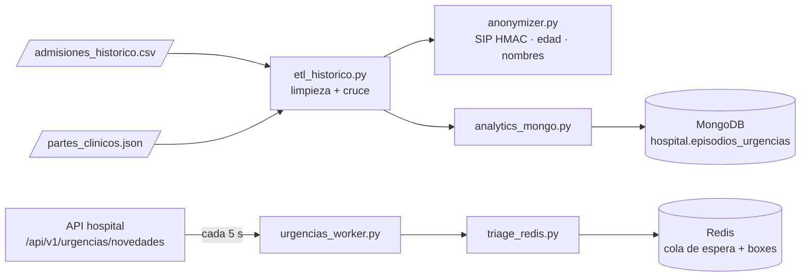

# EmergencyTracker

Herramienta para la gestión del servicio de **Urgencias hospitalarias**: limpia y cruza el histórico de admisiones con los partes clínicos, gestiona en tiempo real la **cola de triaje (Manchester)** y la **asignación de pacientes a boxes** con Redis, carga los episodios en **MongoDB** para su análisis y **anonimiza** los datos de los pacientes.

---

## Índice

1. [Descripción general](#descripción-general)
2. [Arquitectura](#arquitectura)
3. [Tecnologías](#tecnologías)
4. [Estructura del proyecto](#estructura-del-proyecto)
5. [Datos de entrada](#datos-de-entrada)
6. [Módulos](#módulos)
7. [Instalación y puesta en marcha](#instalación-y-puesta-en-marcha)
8. [Comprobar que funciona](#comprobar-que-funciona)
9. [Gestión de errores](#gestión-de-errores)
10. [Equipo](#equipo)
11. [Planificación (Trello)](#planificación-trello)
12. [Cronología del desarrollo](#cronología-del-desarrollo)
13. [Estado actual y trabajo pendiente](#estado-actual-y-trabajo-pendiente)

---

## Descripción general

El proyecto cubre cuatro necesidades de un servicio de Urgencias:

| Bloque | Qué hace | Módulo |
|---|---|---|
| **ETL del histórico** | Lee `admisiones_historico.csv` y `partes_clinicos.json`, limpia errores, normaliza formatos y cruza ambos ficheros por `id_episodio`. | `src/etl_historico.py` |
| **Triaje y boxes en tiempo real** | Consulta cada 5 s la API del hospital, mete los nuevos ingresos en una cola ordenada por prioridad (algoritmo *Earliest Deadline First*), asigna pacientes a los 5 boxes y libera los boxes con las altas. | `src/urgencias_worker.py`, `src/triage_redis.py` |
| **Analítica** | Carga los episodios en MongoDB y calcula la estancia media por patología y el destino al alta por grupo de edad. | `src/analytics_mongo.py` |
| **Anonimización** | Seudonimiza el SIP con HMAC‑SHA256, agrupa la edad en décadas y elimina los nombres. | `src/anonymizer.py` |

---

## Arquitectura



Flujo de `main.py`:

1. Ejecuta el ETL completo (lectura → limpieza → cruce).
2. Anonimiza el DataFrame resultante del ETL.
3. Conecta con Redis (`REDIS_HOST:REDIS_PORT`, por defecto `localhost:6379`) y crea los boxes si no existen.
4. Arranca el worker de urgencias (bucle continuo).

---

## Tecnologías

- **Python 3.11**
- **pandas / numpy**: ETL y limpieza de datos
- **Redis** (`redis-py`): cola de triaje y estado de los boxes en tiempo real
- **MongoDB** (`pymongo`): almacenamiento y consultas de agregación
- **requests**: consumo de la API del hospital
- **python-dotenv**: carga de la clave secreta desde `.env`
- **hmac / hashlib** (librería estándar): anonimización
- **Docker Compose**: contenedores de MongoDB y Redis
- **Git + GitHub** para el código y **Trello** para la organización de tareas

---

## Estructura del proyecto

```
EmergencyTracker/
├── data/
│   ├── admisiones_historico.csv   # Histórico de admisiones (3.605 filas)
│   └── partes_clinicos.json       # Partes clínicos de triaje (3.418 registros)
├── src/
│   ├── config.py                  # Rutas, URL de la API, conexión Mongo y clave HMAC
│   ├── etl_historico.py           # Lectura, limpieza y cruce de datos
│   ├── triage_redis.py            # Boxes y cola de espera en Redis
│   ├── urgencias_worker.py        # Worker que consulta la API del hospital
│   ├── anonymizer.py              # Anonimización de los datos
│   └── analytics_mongo.py         # Carga en MongoDB y consultas analíticas
├── main.py                        # Punto de entrada
├── docker-compose.yml             # Servicios: app, mongodb, redis
├── requirements.txt               # Dependencias de Python
├── .env                           # Clave HMAC_SECRET (no se sube a Git)
└── .gitignore
```

---

## Datos de entrada

Los ficheros históricos se obtienen del servidor remoto del proyecto (`10.201.59.248:8088`); el código trabaja con la copia local de la carpeta `data/`.

### `data/admisiones_historico.csv`

3.605 filas con las columnas:

| Columna | Descripción |
|---|---|
| `id_episodio` | Identificador del episodio (`EP-2026-XXXXX`) |
| `sip_paciente` | Identificador sanitario del paciente (`SIP-XXXXXX`) |
| `timestamp_llegada` / `timestamp_alta` | Fecha y hora de llegada y de alta |
| `motivo_consulta` | `Urgencia por <especialidad>` (9 especialidades) |
| `frecuencia_cardiaca` | Frecuencia cardíaca en admisión |
| `tension_arterial` | Tensión arterial `sistólica/diastólica` |
| `destino_alta` | Domicilio, ingreso en planta, ingreso en pediatría, observación, traslado a UCI, fallecimiento… |


### `data/partes_clinicos.json`

3.418 partes clínicos. Cada uno contiene:

- `_id_parte`, `id_episodio`, `sip_paciente`, `edad`
- `triaje_manchester`: `nivel`, `color`, `categoria_patologia`, `tiempo_max_espera_min`
- `constantes`: `temperatura_c`, `frecuencia_cardiaca_triaje`, `saturacion_o2`, `glucemia_mg_dl`
- `antecedentes` y `alergias` (listas), `notas_triaje` (texto libre)
- Un **módulo de especialidad** según la patología: `modulo_cardiologia`, `modulo_digestivo`, `modulo_neurologia`, `modulo_traumatologia`, `modulo_urologia`, `modulo_pediatria`, `modulo_infeccioso`, `modulo_respiratorio` o `modulo_psiquiatria`, cada uno con sus campos propios (p. ej. Glasgow y NIHSS en neurología, Killip y troponinas en cardiología, qSOFA en infeccioso).


Categorías patológicas: Cardiovascular, Digestivo, Neurología, Traumatología, Nefrourología, Pediatría, Infeccioso, Respiratorio y Psiquiatría.

---

## Módulos

### `src/config.py`

Centraliza la configuración:

- `RUTA_CSV` y `RUTA_JSON`: rutas relativas a la carpeta `data/`.
- `RUTA_API`: `http://10.201.59.248:28000/api/v1/urgencias/novedades`.
- `REDIS_HOST`, `REDIS_PORT`, `MONGO_HOST` y `MONGO_PORT`: se leen de variables de entorno. Si no existen se usa `localhost` con los puertos 6379 y 27017, que es lo que hace falta al ejecutar en local. Dentro de Docker, el `docker-compose.yml` los define con el nombre de cada servicio (`redis` y `mongodb`).
- `MONGO_URI` (se construye como `mongodb://MONGO_HOST:MONGO_PORT`), `MONGO_DB` (`hospital`) y `MONGO_COLLECTION` (`episodios_urgencias`).
- `HMAC_SECRET`: se lee del fichero `.env`. **Si no existe, el programa se detiene** con un `ValueError`.

### `src/etl_historico.py` — Extracción, limpieza y cruce

Función principal: `etl_historico(ruta_csv, ruta_json)` → devuelve un DataFrame con un episodio por fila.

**1. Extracción** (`funcion_lectura`): carga el CSV con `pandas.read_csv` y el JSON con `pandas.read_json`.

**2. Limpieza del CSV** (`limpieza_csv`):

| Paso | Detalle |
|---|---|
| Nulos y duplicados | Elimina filas sin `id_episodio` y duplicados por episodio (se queda con el primero): 3.605 → 3.500 filas. |
| Fechas | Convierte `timestamp_llegada` y `timestamp_alta` a `datetime` en UTC aceptando formatos mezclados (`format='mixed'`, `dayfirst=True`). Lo que no se puede interpretar queda como `NaT`. |
| Textos | `strip()` + minúsculas en todas las columnas de texto. |
| Frecuencia cardíaca | Pasa a numérico; valores ≤ 0 o > 250 → nulo; detecta atípicos con el **rango intercuartílico (IQR, 1,5×)** y los pasa a nulo; imputa los nulos con la **mediana**. |
| Tensión arterial | Sustituye `_` por `/`; `nan` y `pendiente` → `desconocido`. |
| Destino al alta | Nulos y `pendiente` → `desconocido`. |

**3. Limpieza del JSON** (`limpieza_json`):

- Elimina registros sin `id_episodio` y duplicados.
- Normaliza **recursivamente** todos los textos, también dentro de listas y diccionarios anidados (`normalizar_valores_json`).
- Valida las constantes vitales; los valores fuera de rango pasan a `None`:
  - Temperatura: 30–45 °C
  - Frecuencia cardíaca de triaje: 30–250 lpm
  - Saturación de O₂: 0–100 %

**4. Cruce** (`cruzar_datos`): normaliza `id_episodio` en ambos lados y hace un *inner join*. Con los datos actuales se obtienen **3.418 episodios cruzados, sin duplicados**, con 25 columnas.

### `src/triage_redis.py` — Cola de triaje y boxes

Modelo de datos en Redis:

| Clave | Tipo | Contenido |
|---|---|---|
| `box:1` … `box:5` | Hash | `box_id`, `estado` (`LIBRE` / `OCUPADO`), `id_episodio`, `hora_entrada` |
| `urgencias:cola_espera` | Sorted set | Miembro: `id_episodio` · Puntuación: **deadline** del paciente |

**Priorización — Earliest Deadline First (EDF)**: la puntuación de cada paciente es su hora límite de atención:

```
deadline = timestamp_llegada + tiempo_max_espera_min × 60
```

El siguiente paciente en entrar a box es siempre el de **deadline más cercano** (`ZRANGE … 0 0`). Así, un paciente rojo (0 min) que acaba de llegar pasa por delante de un verde que lleva un rato esperando, pero un verde cuyo plazo está a punto de vencer también acaba teniendo prioridad.

Funciones principales:

| Función | Qué hace |
|---|---|
| `inicializar_redis` / `inicializar_boxes` | Crea los 5 boxes en estado `LIBRE` si no existen (no pisa el estado previo). |
| `obtener_boxes`, `obtener_box_libre` | Devuelven el estado de los boxes y el primer box libre. |
| `añadir_paciente_cola_espera` | Calcula el deadline y añade el episodio a la cola con `ZADD NX` (no se duplica). Si el episodio ya ocupa un box, lo ignora. |
| `siguiente_paciente` | Devuelve el episodio con más prioridad sin sacarlo de la cola. |
| `añadir_paciente_box` | Si hay box libre y pacientes esperando, ocupa el box con el siguiente paciente, guarda la hora de entrada y lo quita de la cola. |
| `ocupar_box` / `liberar_box` | Cambian el estado del box. |
| `alta_paciente` | Libera el box del episodio dado de alta o, si aún estaba esperando, lo retira de la cola. |

### `src/urgencias_worker.py` — Worker en tiempo real

- `api_hospital(ruta_api)`: hace `GET` a la API del hospital (timeout de 5 s) y devuelve el JSON.
- `worker_urgencias(r)`: bucle infinito que cada **5 segundos**:
  1. Consulta la API.
  2. Procesa `pacientes_alta` → `alta_paciente`.
  3. Procesa `nuevos_ingresos` → `añadir_paciente_cola_espera`.
  4. Asigna el siguiente paciente de la cola a un box libre.
  5. Muestra el estado de los boxes.

Los errores de red o de datos se capturan y se muestran por consola sin detener el worker.

Formato esperado de la respuesta de la API:

```json
{
  "nuevos_ingresos": [
    {
      "id_episodio": "EP-2026-00001",
      "datos_admision": { "timestamp_llegada": 1794931072 },
      "datos_triaje":   { "tiempo_max_espera_min": 60 }
    }
  ],
  "pacientes_alta": [
    { "id_episodio": "EP-2026-00002" }
  ]
}
```

> `timestamp_llegada` debe ser numérico (segundos *epoch*) porque se le suman los minutos de espera para calcular el deadline.

### `src/anonymizer.py` — Anonimización

Función principal: `anonimizar_dataframe(df, clave)`.

| Dato | Técnica |
|---|---|
| **SIP del paciente** | **HMAC‑SHA256** con la clave `HMAC_SECRET`, truncado a 24 caracteres hexadecimales. Un mismo SIP genera siempre el mismo código, por lo que se pueden seguir relacionando episodios de un paciente sin conocer su identidad, y sin la clave no se puede revertir ni recalcular. Se eliminan las columnas `sip_paciente_x` y `sip_paciente_y` que deja el cruce. |
| **Edad** | Generalización en rangos de 10 años (`40-49`, `70-79`…). Las edades nulas quedan como `desconocido`. |
| **Nombres** | Elimina cualquier columna o clave llamada `nombre`, también dentro de diccionarios y listas anidadas. |

Ejemplo de resultado:

| id_episodio | sip_paciente | edad |
|---|---|---|
| ep-2026-02401 | `72257c9a3e269fbe1307127d` | 10-19 |

### `src/analytics_mongo.py` — Analítica en MongoDB

- `cargar_episodios(documentos)`: crea un **índice único** sobre `id_episodio` e inserta con `insert_many(ordered=False)`, de modo que si se vuelve a ejecutar los duplicados se ignoran y se informa de cuántos se han omitido.
- Antes de cargar, las fechas se convierten a segundos *epoch* para poder restarlas en las agregaciones.

Consultas (pipelines de agregación):

1. **`estancia_media_por_patologia()`**: estancia media en minutos por categoría patológica. Solo episodios cerrados y descartando estancias negativas o superiores a 7 días.
2. **`destino_alta_por_grupo_edad()`**: distribución porcentual del destino al alta por grupo de edad decenal.

Se ejecuta de forma independiente: `python src/analytics_mongo.py`.

### `main.py`

Orquesta la ejecución (ETL → Redis → worker → anonimización) e incluye `redisConecction()`, que conecta con Redis, comprueba la conexión con `ping()` y traduce los errores de conexión, timeout y Redis a mensajes claros.

---

## Instalación y puesta en marcha

### Requisitos

- Python 3.11
- Docker y Docker Compose
- Acceso de red a la API del hospital (`10.201.59.248:28000`, IP de red interna)

### 1. Clonar el repositorio

```bash
git clone https://github.com/Lesterine000/EmergencyTracker.git
cd EmergencyTracker
```

### 2. Crear el entorno virtual e instalar dependencias

```bash
python -m venv venv
# Windows
venv\Scripts\activate
# Linux / macOS
source venv/bin/activate

pip install -r requirements.txt
```

### 3. Crear el fichero `.env`

En la raíz del proyecto (está en `.gitignore`, **nunca se sube al repositorio**):

```env
HMAC_SECRET=pon_aqui_una_clave_larga_y_aleatoria
```

Para generar una clave segura:

```bash
python -c "import secrets; print(secrets.token_hex(32))"
```

> Todo el equipo debe usar **la misma clave** si se quiere que los SIP anonimizados coincidan entre ejecuciones.

### 4. Levantar MongoDB y Redis

El `docker-compose.yml` está en la **raíz del proyecto** (antes estaba en la carpeta `docker/`), así que el comando se lanza desde la carpeta `EmergencyTracker`:

```bash
docker compose up -d mongodb redis
```

Esto levanta `mongodb_container` (puerto 27017) y `redis_container` (puerto 6379).

### 5. Ejecutar

Hay dos formas de ejecutar el programa; el código es el mismo en ambas.

**Opción A — Python en local, MongoDB y Redis en Docker** (con el paso 4 hecho):

```bash
# ETL + anonimización + worker de urgencias en tiempo real
python main.py

# Carga en MongoDB y consultas analíticas
python src/analytics_mongo.py
```

**Opción B — Todo dentro de Docker**:

```bash
docker compose up
```

El servicio `app` usa la imagen `python:3.11-slim`, instala `requirements.txt` y ejecuta `main.py`. Monta la carpeta del proyecto en `/app` (incluido el `.env`) y se conecta a Redis y MongoDB por el nombre de su servicio, gracias a estas variables del `docker-compose.yml`:

```yaml
environment:
  REDIS_HOST: redis
  MONGO_HOST: mongodb
```

Para lanzar la analítica dentro del mismo contenedor, con `app` en marcha:

```bash
docker compose exec app python src/analytics_mongo.py
```

| Variable | Por defecto (local) | En Docker |
|---|---|---|
| `REDIS_HOST` | `localhost` | `redis` |
| `REDIS_PORT` | `6379` | `6379` |
| `MONGO_HOST` | `localhost` | `mongodb` |
| `MONGO_PORT` | `27017` | `27017` |

> No pongas `REDIS_HOST=redis` ni `MONGO_HOST=mongodb` en el `.env`: esos nombres solo existen dentro de la red de Docker, y en local fallaría la conexión. Si alguna vez hace falta, las variables que define `docker-compose.yml` tienen prioridad sobre las del `.env`.

---

## Comprobar que funciona

**Redis** (estado de los boxes y cola de espera):

```bash
docker exec -it redis_container redis-cli
HGETALL box:1
ZRANGE urgencias:cola_espera 0 -1 WITHSCORES
```

**MongoDB**:

```bash
docker exec -it mongodb_container mongosh hospital
db.episodios_urgencias.countDocuments()
db.episodios_urgencias.findOne()
```

---

## Gestión de errores

### Control de errores implementado

| Módulo | Situación | Cómo se gestiona |
|---|---|---|
| `config.py` | No existe `HMAC_SECRET` en `.env` | Se detiene al arrancar con `ValueError` y un mensaje que indica qué falta. |
| `main.py` → `redisConecction()` | Redis caído, sin respuesta o con fallo interno | Comprueba la conexión con `ping()`. Captura `ConnectionError`, `TimeoutError` y `RedisError` y los relanza con un mensaje en español, conservando el error original (`raise … from …`). |
| `urgencias_worker.py` → `api_hospital()` | La API no responde, tarda más de 5 s o devuelve error HTTP | Timeout de 5 s y captura separada de `HTTPError`, `ConnectTimeout`, `ConnectionError` y `RequestException`. |
| `urgencias_worker.py` → `worker_urgencias()` | Cualquier fallo durante un ciclo (red, datos incompletos, Redis) | Se captura, se muestra por consola y el worker **sigue funcionando** en el siguiente ciclo de 5 s; no se cae el servicio. |
| `triage_redis.py` | Paciente repetido, paciente que ya ocupa un box, box inexistente u ocupado, alta de un episodio que no está en Redis | Se comprueba antes de actuar: la cola usa `ZADD NX` para no duplicar, y cada caso se informa por consola devolviendo `False` sin modificar el estado. |
| `etl_historico.py` | Fechas ilegibles, valores no numéricos, constantes imposibles, registros sin identificador o duplicados | Fechas no interpretables → `NaT` (`errors='coerce'`); FC no numérica o atípica → nulo e imputación por mediana (si no hay mediana se avisa); constantes fuera de rango → `None`; registros sin `id_episodio` o duplicados → descartados. |
| `analytics_mongo.py` | Episodios que ya existen en MongoDB al volver a cargar | Índice único sobre `id_episodio` + `insert_many(ordered=False)`; se captura `BulkWriteError` y se informa de cuántos se insertaron y cuántos se omitieron. Las estancias negativas o mayores de 7 días se excluyen de las consultas. |
| `anonymizer.py` | Edad nula | Se agrupa como `desconocido` en lugar de fallar. |

### Errores frecuentes y solución

| Mensaje / síntoma | Causa | Solución |
|---|---|---|
| `ValueError: No se ha encontrado HMAC_SECRET en el archivo .env` | Falta el fichero `.env` o la variable | Crear `.env` en la raíz con `HMAC_SECRET=...`. |
| `ConnectionError: Error de conexión con Redis en localhost:6379` | El contenedor de Redis no está levantado | `docker compose up -d redis` y comprobar con `docker ps`. |
| `Error de conexión con Redis en redis:6379 … Name or service not known` | Se ejecuta en local con `REDIS_HOST=redis` (o `MONGO_HOST=mongodb`) definido | Quitar esa variable del `.env` o de la terminal; en local debe ser `localhost`. |
| `ServerSelectionTimeoutError` (pymongo) | MongoDB no está levantado | `docker compose up -d mongodb`. |
| `Error en el worker: ...` repetido cada 5 s | La API del hospital no es accesible | Comprobar que se está en la red interna y que `http://10.201.59.248:28000/api/v1/urgencias/novedades` responde. |
| `no configuration file provided: not found` | `docker compose` lanzado fuera de la raíz | Ejecutarlo desde la carpeta `EmergencyTracker` (el compose ya **no** está en `docker/`). |
| `ModuleNotFoundError: No module named 'src'` | `main.py` ejecutado desde otra carpeta | Ejecutar `python main.py` desde la raíz del proyecto. |
| `ModuleNotFoundError: No module named 'config'` | `analytics_mongo.py` lanzado como módulo | Ejecutar `python src/analytics_mongo.py`. |
| `port is already allocated` (6379 o 27017) | Ya hay un Redis o MongoDB local usando el puerto | Parar el servicio local o cambiar el puerto en `docker-compose.yml`. |
| `FileNotFoundError: ... data/...` | Faltan los ficheros de datos | Comprobar que `admisiones_historico.csv` y `partes_clinicos.json` están en `data/`. |

---

## Equipo

| Integrante | GitHub | Aportaciones principales |
|---|---|---|
| **Lester AG** | `Lesterine000` | Creación del repositorio y del tablero de Trello, usuarios del servidor para el equipo, entorno virtual y `.gitignore`, `requirements.txt`, configuración base e ingesta, conexión a MongoDB, carga masiva e índices, consultas de agregación (`analytics_mongo.py`) y reubicación del `docker-compose.yml` a la raíz. |
| **Daniel Mateos Rodríguez** | `DANIEL MATEOS RODRÍGUEZ` / `Daniel` | Estructura de directorios, prueba e integración de los `compose.yml` de MongoDB, Redis y Python en uno solo, paso a rutas relativas, limpieza estructural (nulos, duplicados y fechas), depuración de constantes y normalización de textos, anonimizador y gestión de la clave en `.env`. |
| **Luis Alberto Álvarez** | `LuisTona` | Llamada de prueba a la API REST, funciones de limpieza CSV/JSON, rutas en `config.py`, `main.py`, conexión Python–Redis, worker de urgencias, motor de colas y asignación de boxes, conexión con Redis desde `main.py`. |
| **Víctor González Suárez** | `VICTOR GONZALEZ SUAREZ` | Función para obtener y leer los ficheros CSV y JSON, carga de datos en pandas, librerías del proyecto, cambios en el worker de urgencias y `main.py`, completar el módulo de triaje. |

---


Criterios de finalización definidos para el motor de colas:

- Los pacientes se ordenan por su límite de atención.
- Los 5 boxes reflejan su ocupante y hora de entrada.
- Los pacientes más prioritarios reciben los boxes disponibles.
- Las altas liberan automáticamente los boxes.
- Las novedades de la API se procesan sin duplicar pacientes.
- Los episodios finalizados se guardan en MongoDB antes de eliminarse de Redis.

---

## Cronología del desarrollo

| Fecha | Hito |
|---|---|
| 07/10/2026 | Creación del repositorio. |
| 15/10/2026 | Estructura de carpetas, `docker-compose`, función de lectura de ficheros y librerías. |
| 22/10/2026 | Primera consulta a la API del hospital, entorno virtual y `.gitignore`, limpieza de archivos sobrantes y rutas relativas. |
| 23–29/10/2026 | `requirements.txt`, rutas en `config.py`, `main.py` y funciones de limpieza del CSV y del JSON. |
| 05/11/2026 | Worker de urgencias con API y Redis, fin de la limpieza de datos, configuración de MongoDB para la ingesta. |
| 11–12/11/2026 | Consultas analíticas en MongoDB, `docker-compose.yml` a la raíz, triaje con gestión de pacientes y boxes, worker integrado con el triaje, primera versión del anonimizador. |
| 15–16/11/2026 | Anonimizador terminado e integrado en `main.py`, conexión con Redis e inicialización del worker desde `main.py`. |

---

## Estado actual y trabajo pendiente

**Hecho**

- [x] ETL completo: lectura, limpieza de CSV y JSON, cruce por episodio.
- [x] Cola de triaje priorizada por deadline Manchester y gestión de 5 boxes en Redis.
- [x] Worker que consulta la API del hospital cada 5 segundos.
- [x] Carga en MongoDB con índice único y dos consultas analíticas.
- [x] Anonimización de SIP, edad y nombres.

**Pendiente / mejoras detectadas**

- [ ] Guardar en MongoDB los episodios dados de alta antes de liberarlos en Redis (último criterio de la tarjeta del motor de colas).
- [ ] Detectar y corregir episodios con fecha de alta anterior a la de llegada en el ETL (ahora solo se descartan en la consulta de estancia media).
- [x] `main.py`: la anonimización se ejecuta antes de arrancar el worker (antes iba detrás del bucle infinito y nunca llegaba a ejecutarse).
- [ ] `main.py`: el DataFrame anonimizado no se guarda; conviene guardarlo o cargarlo en MongoDB.
- [ ] `analytics_mongo.py` no se llama desde `main.py` y carga los datos **sin anonimizar**.
- [ ] Consulta 1 de MongoDB: `categoria_patologia` está dentro de `triaje_manchester`, por lo que el filtro debería usar `triaje_manchester.categoria_patologia`; tal como está no devuelve resultados.
- [ ] Consulta 2 de MongoDB: filtra `"Desconocido"`, pero el ETL lo deja en minúsculas (`"desconocido"`).
- [ ] Unificar los valores de `destino_alta` (`alta_traslado_uci` / `traslado_uci`, `alta_domicilio` / `domicilio`, `alta`…).
- [ ] `urgencias_worker.api_hospital`: `raise(f"...")` lanza una cadena (provoca `TypeError` en vez del mensaje previsto) y si la API no devuelve 200 la función devuelve `None`. El worker no se cae porque lo captura el `except` general, pero el mensaje que se muestra no es el correcto. Solución: `raise ConnectionError(f"...") from error` y `response.raise_for_status()`.
- [x] `triage_redis.py`: eliminadas las funciones duplicadas por el merge.
- [ ] `triage_redis.py`: `liberar_box` no devuelve `True`, por lo que `alta_paciente` libera el box pero no lo informa.
- [ ] El worker asigna como máximo un paciente por ciclo de 5 segundos aunque haya varios boxes libres.
- [x] Hosts de Redis y MongoDB leídos de variables de entorno (`REDIS_HOST`, `MONGO_HOST`…) para poder ejecutar el servicio `app` dentro de Docker.
- [ ] Fijar la versión de `python-dotenv` en `requirements.txt`.
